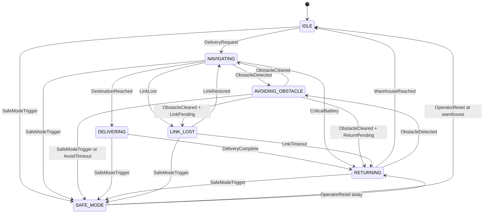

# Task 3: State Modelling & Transition Verification

**Model version:** v1.1 (includes Safe Mode from CR-01 and Link Lost)

## 1. States

| ID | State | Meaning | Entry condition | Exit condition |
|---|---|---|---|---|
| S-01 | IDLE | On, at warehouse, waiting | Power on; WarehouseReached; OperatorReset at warehouse | Valid DeliveryRequest; SafeModeTrigger |
| S-02 | NAVIGATING | Driving to destination, checking obstacles and crossing | DeliveryRequest; ObstacleCleared (came from NAVIGATING); LinkRestored | ObstacleDetected; DestinationReached; CriticalBattery; LinkLost; SafeModeTrigger |
| S-03 | AVOIDING_OBSTACLE | Trip suspended, going around an obstacle | ObstacleDetected from NAVIGATING or RETURNING | ObstacleCleared; AvoidTimeout; SafeModeTrigger |
| S-04 | DELIVERING | At destination, handing package to confirmed clinic staff | DestinationReached from NAVIGATING only | DeliveryComplete; SafeModeTrigger |
| S-05 | RETURNING | Travelling back to the warehouse | DeliveryComplete; CriticalBattery; LinkTimeout; OperatorReset away; ObstacleCleared with ReturnPending | WarehouseReached; ObstacleDetected; SafeModeTrigger |
| S-06 | SAFE_MODE | Stopped in a safe place, chamber protection keeps running | SafeModeTrigger; AvoidTimeout | OperatorReset (authenticated, authorised, fault cleared) |
| S-07 | LINK_LOST | Stopped at a safe place, retrying the link | LinkLost from NAVIGATING; ObstacleCleared with LinkPending | LinkRestored; LinkTimeout; CriticalBattery; SafeModeTrigger |

## 2. Events

| ID | Event | Meaning |
|---|---|---|
| E-01 | DeliveryRequest | Valid, authorised delivery command arrives |
| E-02 | ObstacleDetected | Sensors see something in the path |
| E-03 | ObstacleCleared | Path is free |
| E-04 | DestinationReached | Robot arrives at the clinic |
| E-05 | DeliveryComplete | Handover finished |
| E-06 | CriticalBattery | Battery at or below 20% |
| E-07 | WarehouseReached | Robot arrives at the warehouse |
| E-08 | SafeModeTrigger | Temperature above critical, OR battery below 10%, OR serious fault |
| E-09 | LinkLost | No link for 30 seconds |
| E-10 | LinkRestored | Link is back |
| E-11 | LinkTimeout | Link down for 5 minutes |
| E-12 | OperatorReset | Authorised operator clears Safe Mode |
| E-13 | AvoidTimeout | Avoidance lasted 120 seconds |

### State vs event
- A **state** is a condition the robot stays in for some time. It answers "What is the robot doing now?" Example: NAVIGATING.
- An **event** happens at one moment and may cause a change. It answers "What just happened?" Example: ObstacleDetected.
- A door being **open** is a state. Someone **pushing** the door is an event.
- A transition joins them: Current State + Event gives Next State.

## 3. State Transition Table

Rules:
- Words in [brackets] are guards (extra conditions).
- In AVOIDING_OBSTACLE and DELIVERING the robot finishes its action first and remembers the problem with a flag (ReturnPending or LinkPending), because stopping half way is unsafe.
- ReturnPending wins over LinkPending.
- SafeModeTrigger always acts at once.
- Unlisted events are ignored and logged.

| T-ID | Current | Event [Guard] | Next | Req. | Valid? | Evidence |
|---|---|---|---|---|---|---|
| T-01 | IDLE | DeliveryRequest [valid, authorised, battery above 20%] | NAVIGATING | FR-03, FR-01, FR-02 | Valid | TC-05, 22 |
| T-02 | NAVIGATING | ObstacleDetected | AVOIDING_OBSTACLE | FR-04 | Valid | TC-14 |
| T-03 | AVOIDING_OBSTACLE | ObstacleCleared [from NAVIGATING, no flag] | NAVIGATING | FR-04 | Valid | TC-14 |
| T-04 | NAVIGATING | DestinationReached | DELIVERING | FR-03, SR-03 | Valid | TC-22 |
| T-05 | DELIVERING | DeliveryComplete | RETURNING | FR-03 | Valid | TC-22 |
| T-06 | RETURNING | WarehouseReached | IDLE | FR-03 | Valid | TC-22 |
| T-07 | NAVIGATING | CriticalBattery | RETURNING | FR-03 | Valid | TC-21 |
| T-08 | AVOIDING_OBSTACLE | CriticalBattery | AVOIDING_OBSTACLE (set ReturnPending) | FR-03 | Missing, added | TC-21 |
| T-09 | AVOIDING_OBSTACLE | ObstacleCleared [ReturnPending] | RETURNING | FR-03, FR-04 | Missing, added | TC-21 |
| T-10 | DELIVERING | CriticalBattery | DELIVERING (finish handover, then T-05) | FR-03 | Missing, added | TC-21 |
| T-11 | RETURNING | CriticalBattery | RETURNING (alert operator) | FR-03 | Missing, added | TC-21 |
| T-12 | IDLE | CriticalBattery | IDLE (refuse new requests, alert) | FR-03, FR-08 | Missing, added | TC-21 |
| T-13 | RETURNING | ObstacleDetected | AVOIDING_OBSTACLE (remember RETURNING) | FR-04 | Missing, added | TC-14 |
| T-14 | AVOIDING_OBSTACLE | ObstacleCleared [from RETURNING] | RETURNING | FR-04 | Missing, added | TC-14 |
| T-15 | DELIVERING | ObstacleDetected | DELIVERING (standing still, log) | SR-03 | Valid | TC-13 |
| T-16 | AVOIDING_OBSTACLE | DestinationReached | AVOIDING_OBSTACLE (ignore, log) | SR-03 | Valid | TC-13 |
| T-17 | IDLE | DeliveryRequest | DELIVERING | SR-03, FR-03 | **Invalid** | TC-13 |
| T-18 | AVOIDING_OBSTACLE | DestinationReached or ObstacleCleared | DELIVERING | SR-03 | **Invalid** | TC-13 |
| T-19 | AVOIDING_OBSTACLE | ObstacleCleared | (no transition defined) | FR-04 | **Invalid (missing return)** | TC-14 |
| T-20 | IDLE | SafeModeTrigger | SAFE_MODE | FR-08 | Valid | TC-08 |
| T-21 | NAVIGATING | SafeModeTrigger | SAFE_MODE | FR-08 | Valid | TC-08, 09 |
| T-22 | AVOIDING_OBSTACLE | SafeModeTrigger | SAFE_MODE | FR-08 | Valid | TC-08 |
| T-23 | DELIVERING | SafeModeTrigger | SAFE_MODE | FR-08 | Valid | TC-08 |
| T-24 | RETURNING | SafeModeTrigger | SAFE_MODE | FR-08 | Valid | TC-08, 09 |
| T-25 | LINK_LOST | SafeModeTrigger | SAFE_MODE | FR-08, SR-02 | Valid | TC-08, 12 |
| T-26 | SAFE_MODE | OperatorReset [authenticated, authorised, fault cleared, at warehouse] | IDLE | FR-08, FR-01 | Valid | TC-03, 08 |
| T-27 | SAFE_MODE | OperatorReset [same checks, away from warehouse] | RETURNING | FR-08, FR-01 | Valid | TC-08 |
| T-28 | SAFE_MODE | DeliveryRequest | SAFE_MODE (reject, log) | FR-08, FR-02 | Valid | TC-04 |
| T-29 | SAFE_MODE | OperatorReset | DELIVERING or NAVIGATING | FR-08, SR-03 | **Invalid** | TC-13 |
| T-30 | NAVIGATING | LinkLost [not on crossing; if on crossing, finish it first] | LINK_LOST | SR-02 | Valid | TC-12 |
| T-31 | AVOIDING_OBSTACLE | LinkLost | AVOIDING_OBSTACLE (set LinkPending) | SR-02 | Valid | TC-12 |
| T-32 | AVOIDING_OBSTACLE | ObstacleCleared [LinkPending, no ReturnPending] | LINK_LOST | SR-02 | Valid | TC-12 |
| T-33 | LINK_LOST | LinkRestored | NAVIGATING (re-check crossing permission) | SR-02, SR-01 | Valid | TC-12 |
| T-34 | LINK_LOST | LinkTimeout | RETURNING | SR-02 | Valid | TC-12 |
| T-35 | LINK_LOST | CriticalBattery | RETURNING | SR-02, FR-03 | Valid | TC-12, 21 |
| T-36 | IDLE | LinkLost | IDLE (log, alarm) | SR-02 | Valid | TC-12 |
| T-37 | DELIVERING | LinkLost | DELIVERING (finish handover) | SR-02 | Valid | TC-12 |
| T-38 | RETURNING | LinkLost | RETURNING (stored route, log) | SR-02 | Valid | TC-12 |
| T-39 | SAFE_MODE | LinkLost | SAFE_MODE (log) | SR-02 | Valid | TC-12 |
| T-40 | AVOIDING_OBSTACLE | AvoidTimeout | SAFE_MODE | FR-04, FR-08 | Missing, added | TC-14 |

### Diagram

## 4. Safe Mode (CR-01) and Link Lost: which states may enter?

| From | Safe Mode? | Link Lost? |
|---|---|---|
| IDLE | Yes (chamber or battery can still overheat) | No, stay IDLE, log and alarm (already parked) |
| NAVIGATING | Yes | Yes, but not while on the crossing |
| AVOIDING_OBSTACLE | Yes, at once (also on 120 s timeout) | Yes, after the obstacle is cleared (stopping half way is unsafe) |
| DELIVERING | Yes, at once (medicine at risk matters more) | No, finish the handover (a few seconds), then RETURNING |
| RETURNING | Yes | No, keep going home on the stored route (the warehouse is the safest place) |
| LINK_LOST | Yes | Not applicable |
| SAFE_MODE | Not applicable | No, stay and log |

Safe Mode is left **only** by OperatorReset, and never goes straight to NAVIGATING or DELIVERING.

## 5. Verifier investigation

**(a) Can IDLE to DELIVERING happen?**
Only if someone adds a wrong rule (T-17). The original text never forbids it. It violates **SR-03** and FR-03. The robot would "deliver" at the warehouse and skip route planning, the railway check and the chamber checks. Fix: the only way into DELIVERING is T-04. Test: TC-13.

**(b) AVOIDING_OBSTACLE with no way back?**
The robot cannot deliver, because the only path to DELIVERING goes through NAVIGATING. But it is stuck forever (a deadlock): the battery drains, the medicine warms, and it may block the path. A developer might "fix" it with AVOIDING to DELIVERING, which is unsafe. Fix: keep T-03, add T-09 and T-14, and add T-40 (120 s timeout to SAFE_MODE). Test: TC-14.

**(c) AVOIDING_OBSTACLE to DELIVERING?**
It must not occur (T-18, Invalid). It violates **SR-03**. The robot may not be at the destination, and the obstacle may be a person. Fix: DestinationReached is ignored while avoiding (T-16). Test: TC-13.

**(d) CriticalBattery in AVOIDING_OBSTACLE or DELIVERING?**
The original rule exists only for NAVIGATING, so the event would be ignored. The robot could run on a nearly empty battery and stop on the route or on the railway crossing. Fixes:
- AVOIDING_OBSTACLE: finish the manoeuvre, then go home (T-08, T-09).
- DELIVERING: finish the short handover, then return (T-10, T-05).
- Battery below 10%: Safe Mode at once (T-22, T-23).

Test: TC-21.

### Other problems found

| ID | Problem | Fix |
|---|---|---|
| B-01 | Obstacle while RETURNING would send the robot back to NAVIGATING, so it drives to the clinic again | Remember where it came from (T-13, T-14) |
| B-02 | No time limit while avoiding | AvoidTimeout (T-40) |
| B-03 | CriticalBattery missing in IDLE, RETURNING, AVOIDING, DELIVERING | T-08 to T-12 |
| B-04 | LinkLost on the crossing would stop the robot on the track | Guard in T-30 and constraint C-09 |
| B-05 | ReturnPending and LinkPending both set | ReturnPending wins |
| B-06 | Safe Mode left by a normal request, then straight to delivery | T-28, T-29: only OperatorReset leaves, only to IDLE or RETURNING |
