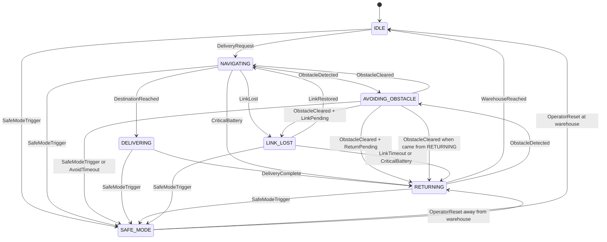

# Task 3: State Modelling & Transition Verification

**Project:** SACDCS (Delivery Robot)
**Model version:** v1.1 (includes Safe Mode from CR-01 and Link Lost)

---

## 1. States

| State ID | State | Meaning | Entry condition | Exit condition |
|---|---|---|---|---|
| S-01 | IDLE | Robot is on, at the warehouse, waiting for a request. | Power on; WarehouseReached from RETURNING; OperatorReset at the warehouse. | A valid DeliveryRequest; SafeModeTrigger. |
| S-02 | NAVIGATING | Robot drives to the destination, checks for obstacles and asks the railway crossing for permission. | DeliveryRequest from IDLE; ObstacleCleared from AVOIDING_OBSTACLE (when it came from NAVIGATING); LinkRestored from LINK_LOST. | ObstacleDetected; DestinationReached; CriticalBattery; LinkLost; SafeModeTrigger. |
| S-03 | AVOIDING_OBSTACLE | Robot has suspended its trip and is going around an obstacle. | ObstacleDetected from NAVIGATING or from RETURNING. | ObstacleCleared; AvoidTimeout; SafeModeTrigger. |
| S-04 | DELIVERING | Robot is at the destination, handing the package to confirmed clinic staff. | DestinationReached from NAVIGATING only. | DeliveryComplete; SafeModeTrigger. |
| S-05 | RETURNING | Robot travels back to the warehouse. | DeliveryComplete; CriticalBattery; LinkTimeout; OperatorReset away from the warehouse; ObstacleCleared with ReturnPending. | WarehouseReached; ObstacleDetected; SafeModeTrigger. |
| S-06 | SAFE_MODE | Robot is stopped in a safe place (never on the crossing). The chamber protection keeps running. Only an operator can leave this state. | SafeModeTrigger; AvoidTimeout. | OperatorReset (authenticated, role-authorised, fault cleared). |
| S-07 | LINK_LOST | Robot has stopped at a safe place because Mission Control cannot be reached. It keeps trying to reconnect. | LinkLost from NAVIGATING; ObstacleCleared with LinkPending. | LinkRestored; LinkTimeout; CriticalBattery; SafeModeTrigger. |

---

## 2. Events

| Event ID | Event | Meaning |
|---|---|---|
| E-01 | DeliveryRequest | A valid, authorised delivery command arrives. |
| E-02 | ObstacleDetected | The sensors see something in the path. |
| E-03 | ObstacleCleared | The path is free again. |
| E-04 | DestinationReached | The robot arrives at the clinic. |
| E-05 | DeliveryComplete | The package handover is finished. |
| E-06 | CriticalBattery | Battery is at or below 20%. |
| E-07 | WarehouseReached | The robot arrives at the warehouse. |
| E-08 | SafeModeTrigger | Chamber or battery temperature above critical, OR battery below 10%, OR a serious fault. |
| E-09 | LinkLost | No link to Mission Control for 30 seconds. |
| E-10 | LinkRestored | Link is back. |
| E-11 | LinkTimeout | Link has been down for 5 minutes. |
| E-12 | OperatorReset | An authenticated, role-authorised operator clears Safe Mode. |
| E-13 | AvoidTimeout | Obstacle avoidance has lasted 120 seconds. |

### State and event: what is the difference?

- A **state** is a condition the robot **stays in** for some time. It answers "What is the robot doing right now?" Example: the robot is NAVIGATING.
- An **event** is something that **happens at one moment** and may cause a change. It answers "What just happened?" Example: ObstacleDetected.
- Simple example: a door being **open** is a state. Someone **pushing** the door is an event. The push can change the state from closed to open.
- A transition is the link between them: **Current State + Event → Next State**.

---

## 3. State Transition Table

Rules used in the table:
- **Guard** (in square brackets) is an extra condition that must be true.
- **Flag**: in AVOIDING_OBSTACLE and DELIVERING the robot must finish what it is doing before it reacts to a battery or link problem, because stopping half way is unsafe. So it remembers the problem (ReturnPending or LinkPending) and acts when the action is finished.
- If both ReturnPending and LinkPending are set, ReturnPending wins (go home).
- Emergencies (SafeModeTrigger) always act immediately.
- Any event not listed for a state is ignored and written to the log.
- Valid? means: **Valid** = allowed and safe, **Invalid** = must never happen, **Missing, added** = the original description had no rule and I added one.

| T-ID | Current State | Event [Guard] | Next State | Req. ID | Valid? | Evidence |
|---|---|---|---|---|---|---|
| T-01 | IDLE | DeliveryRequest [valid, authorised, battery above 20%] | NAVIGATING | FR-03, FR-01, FR-02 | Valid | TC-05, TC-22 |
| T-02 | NAVIGATING | ObstacleDetected | AVOIDING_OBSTACLE | FR-04 | Valid | TC-14 |
| T-03 | AVOIDING_OBSTACLE | ObstacleCleared [came from NAVIGATING, no flag] | NAVIGATING | FR-04 | Valid | TC-14 |
| T-04 | NAVIGATING | DestinationReached | DELIVERING | FR-03, SR-03 | Valid | TC-22 |
| T-05 | DELIVERING | DeliveryComplete | RETURNING | FR-03 | Valid | TC-22 |
| T-06 | RETURNING | WarehouseReached | IDLE | FR-03 | Valid | TC-22 |
| T-07 | NAVIGATING | CriticalBattery | RETURNING | FR-03 | Valid | TC-21 |
| T-08 | AVOIDING_OBSTACLE | CriticalBattery | AVOIDING_OBSTACLE (set ReturnPending) | FR-03 | Missing, added | TC-21 |
| T-09 | AVOIDING_OBSTACLE | ObstacleCleared [ReturnPending] | RETURNING | FR-03, FR-04 | Missing, added | TC-21 |
| T-10 | DELIVERING | CriticalBattery | DELIVERING (finish handover, then T-05) | FR-03 | Missing, added | TC-21 |
| T-11 | RETURNING | CriticalBattery | RETURNING (no change, alert operator) | FR-03 | Missing, added | TC-21 |
| T-12 | IDLE | CriticalBattery | IDLE (refuse new requests, alert operator) | FR-03, FR-08 | Missing, added | TC-21 |
| T-13 | RETURNING | ObstacleDetected | AVOIDING_OBSTACLE (remember it came from RETURNING) | FR-04 | Missing, added | TC-14 |
| T-14 | AVOIDING_OBSTACLE | ObstacleCleared [came from RETURNING] | RETURNING | FR-04 | Missing, added | TC-14 |
| T-15 | DELIVERING | ObstacleDetected | DELIVERING (robot is standing still; log it) | SR-03 | Valid | TC-13 |
| T-16 | AVOIDING_OBSTACLE | DestinationReached | AVOIDING_OBSTACLE (ignore and log) | SR-03 | Valid | TC-13 |
| T-17 | IDLE | DeliveryRequest | DELIVERING | SR-03, FR-03 | **Invalid** | TC-13 |
| T-18 | AVOIDING_OBSTACLE | DestinationReached or ObstacleCleared | DELIVERING | SR-03 | **Invalid** | TC-13 |
| T-19 | AVOIDING_OBSTACLE | ObstacleCleared | (no transition defined) | FR-04 | **Invalid (missing return)** | TC-14 |
| T-20 | IDLE | SafeModeTrigger | SAFE_MODE | FR-08 | Valid | TC-08 |
| T-21 | NAVIGATING | SafeModeTrigger | SAFE_MODE | FR-08 | Valid | TC-08, TC-09 |
| T-22 | AVOIDING_OBSTACLE | SafeModeTrigger | SAFE_MODE | FR-08 | Valid | TC-08 |
| T-23 | DELIVERING | SafeModeTrigger | SAFE_MODE | FR-08 | Valid | TC-08 |
| T-24 | RETURNING | SafeModeTrigger | SAFE_MODE | FR-08 | Valid | TC-08, TC-09 |
| T-25 | LINK_LOST | SafeModeTrigger | SAFE_MODE | FR-08, SR-02 | Valid | TC-08, TC-12 |
| T-26 | SAFE_MODE | OperatorReset [authenticated, role-authorised, fault cleared, robot at warehouse] | IDLE | FR-08, FR-01 | Valid | TC-03, TC-08 |
| T-27 | SAFE_MODE | OperatorReset [same checks, robot away from warehouse] | RETURNING | FR-08, FR-01 | Valid | TC-08 |
| T-28 | SAFE_MODE | DeliveryRequest | SAFE_MODE (reject, log) | FR-08, FR-02 | Valid | TC-04 |
| T-29 | SAFE_MODE | OperatorReset | DELIVERING or NAVIGATING | FR-08, SR-03 | **Invalid** | TC-13 |
| T-30 | NAVIGATING | LinkLost [robot not on crossing; if on crossing, finish crossing first] | LINK_LOST | SR-02 | Valid | TC-12 |
| T-31 | AVOIDING_OBSTACLE | LinkLost | AVOIDING_OBSTACLE (set LinkPending) | SR-02 | Valid | TC-12 |
| T-32 | AVOIDING_OBSTACLE | ObstacleCleared [LinkPending, no ReturnPending] | LINK_LOST | SR-02 | Valid | TC-12 |
| T-33 | LINK_LOST | LinkRestored | NAVIGATING (re-check crossing permission first) | SR-02, SR-01 | Valid | TC-12 |
| T-34 | LINK_LOST | LinkTimeout | RETURNING | SR-02 | Valid | TC-12 |
| T-35 | LINK_LOST | CriticalBattery | RETURNING | SR-02, FR-03 | Valid | TC-12, TC-21 |
| T-36 | IDLE | LinkLost | IDLE (log, alarm) | SR-02 | Valid | TC-12 |
| T-37 | DELIVERING | LinkLost | DELIVERING (finish handover, log) | SR-02 | Valid | TC-12 |
| T-38 | RETURNING | LinkLost | RETURNING (go home on the stored route, log) | SR-02 | Valid | TC-12 |
| T-39 | SAFE_MODE | LinkLost | SAFE_MODE (log) | SR-02 | Valid | TC-12 |
| T-40 | AVOIDING_OBSTACLE | AvoidTimeout | SAFE_MODE | FR-04, FR-08 | Missing, added | TC-14 |

---

### State Transition Diagram

**How to read the diagram**

- Each box is a state and each arrow is a transition. The word on the arrow is the event that causes it.
- The diagram shows only the **valid** transitions. The invalid ones from the table (T-17, T-18, T-19, T-29) are deliberately missing, because they must never exist. For example, there is no arrow from IDLE to DELIVERING, and none from AVOIDING_OBSTACLE to DELIVERING.
- Events that leave the state unchanged (for example CriticalBattery while IDLE) are in the table but not drawn, because they would only be loops.

## 4. Safe Mode (CR-01) and Link Lost: which states may enter them?

### Safe Mode (S-06)

| From state | May enter Safe Mode? | Reason |
|---|---|---|
| IDLE | Yes | The chamber or battery can still overheat while waiting. |
| NAVIGATING | Yes | Most likely place for a battery or thermal problem. |
| AVOIDING_OBSTACLE | Yes, at once | Emergencies are never delayed. Also used when avoidance lasts 120 seconds. |
| DELIVERING | Yes, at once | A medicine at risk is more important than finishing the handover. |
| RETURNING | Yes | Same reasons as NAVIGATING. |
| LINK_LOST | Yes | A critical problem can still happen when the link is down. |

Safe Mode leaves **only** by OperatorReset (authenticated, role-authorised), and **never** goes to NAVIGATING or DELIVERING directly.

### Link Lost (S-07)

| From state | May enter Link Lost? | Reason |
|---|---|---|
| IDLE | No (stay IDLE, log and alarm) | The robot is already parked at the warehouse. |
| NAVIGATING | Yes (not while on the crossing) | A robot driving without supervision must stop at a safe place. |
| AVOIDING_OBSTACLE | Yes, after the obstacle is cleared | Stopping half way around an obstacle is unsafe. |
| DELIVERING | No (finish handover, then RETURNING) | A few seconds of handover is safe to finish, and RETURNING runs without help. |
| RETURNING | No (continue home, log) | Going to the warehouse is the safest place to be anyway. |
| SAFE_MODE | No (stay SAFE_MODE, log) | Already stopped and safe. |

---

## 5. Verifier investigation (hunting for behaviour problems)

### (a) Can IDLE → DELIVERING happen?
- **Only if someone adds the wrong rule** (row T-17). The original text never gives such a rule, but it does not forbid it either, so a careless design could add it.
- **Requirement violated:** SR-03 (never enter DELIVERING except from NAVIGATING) and FR-03 (a delivery must be preceded by navigation).
- **Why it is dangerous:** the robot would "deliver" at the warehouse. It would skip route planning, the railway crossing check and the chamber checks.
- **Fix:** the only way into DELIVERING is T-04 (NAVIGATING + DestinationReached). Test: TC-13.

### (b) What if AVOIDING_OBSTACLE has no transition back? Can the robot still deliver?
- **No, it cannot deliver.** The only way to DELIVERING goes through NAVIGATING (T-04). The robot is stuck forever (this is a **deadlock**), so it is safe but useless.
- **Other problems:** the battery runs down, the medicine warms up, and the robot may block the path. Also a developer might "fix" it by adding AVOIDING_OBSTACLE → DELIVERING, which is unsafe (see c).
- **Fix:** keep T-03 (return to NAVIGATING), add T-09 and T-14 (return to the right state), and add T-40 (after 120 seconds go to SAFE_MODE so it is never stuck forever). Test: TC-14.

### (c) Can AVOIDING_OBSTACLE → DELIVERING occur?
- **It must not occur** (row T-18, marked Invalid).
- **Requirement violated:** SR-03 (never deliver while handling an obstacle).
- **Why:** the robot may not be at the destination, and the obstacle may be a person or a vehicle close to it.
- **Fix:** while in AVOIDING_OBSTACLE, the event DestinationReached is ignored and logged (T-16). Test: TC-13.

### (d) What happens on CriticalBattery in AVOIDING_OBSTACLE or DELIVERING?
- In the original description the rule exists **only for NAVIGATING**. In AVOIDING_OBSTACLE and DELIVERING there is **no transition**, so the event would be ignored. The robot could carry on with a nearly empty battery and stop on the route, or on the railway crossing.
- **Fix, AVOIDING_OBSTACLE:** finish the manoeuvre, then go home (T-08 and T-09).
- **Fix, DELIVERING:** finish the short handover, then return (T-10 then T-05).
- **If the battery is very low (below 10%):** SafeModeTrigger acts at once (T-22, T-23).
- Test: TC-21.

### Other problems found while checking

| Bug ID | Problem | Fix |
|---|---|---|
| B-01 | If an obstacle appears while RETURNING, the original single return rule sends the robot back to NAVIGATING, so it would turn round and drive **to the clinic again**. | The robot remembers where it came from (T-13, T-14). |
| B-02 | No time limit in AVOIDING_OBSTACLE. | AvoidTimeout (T-40). |
| B-03 | CriticalBattery is missing in IDLE, RETURNING, AVOIDING_OBSTACLE and DELIVERING. | T-08 to T-12. |
| B-04 | LinkLost while the robot is on the railway crossing would make it stop on the track. | Guard in T-30: finish crossing first. Constraint C-09 (Task 5). |

| B-05 | ReturnPending and LinkPending could both be set. | ReturnPending wins (rule in section 3). |
| B-06 | Safe Mode could be left by a normal request and then go straight to delivery. | T-28 and T-29: only OperatorReset leaves it, and only to IDLE or RETURNING. |
